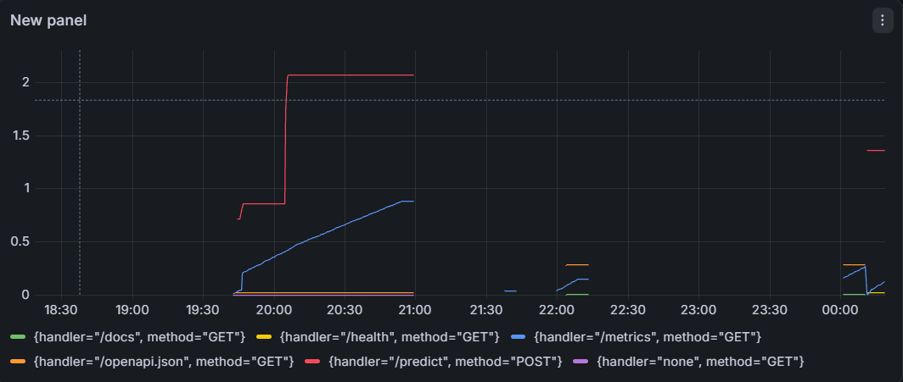
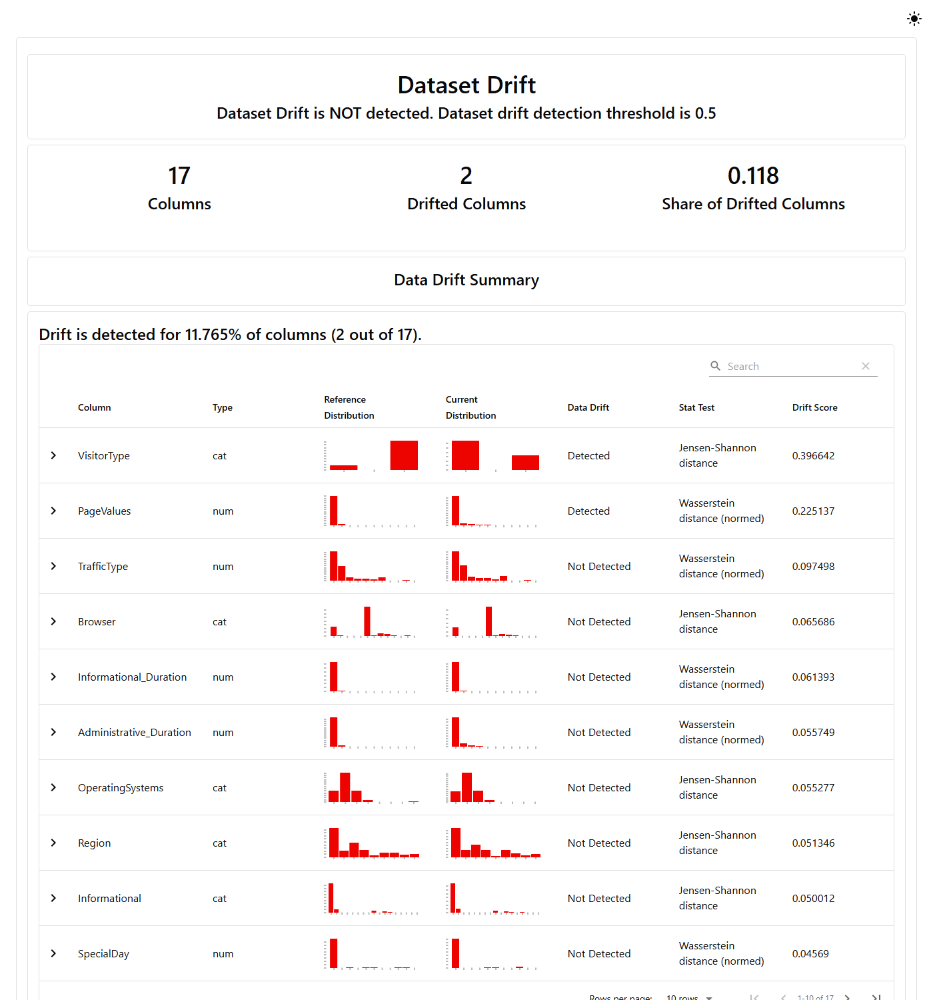

# Proyecto integrador · Equipo Online Shopper

Curso Despliegue y monitoreo de Machine Learning.

| | |
|---|---|
| Dataset | [Online Shoppers Purchasing Intention](https://archive.ics.uci.edu/dataset/468/online+shoppers+purchasing+intention+dataset) (UCI) · `data/raw/online_shoppers_intention.csv`: 12 330 sesiones de una tienda online, 17 variables + `Revenue` |
| Pregunta de negocio | ¿Una sesión de navegación terminará en compra (`Revenue`)? Sirve para dirigir promociones o ayuda en tiempo real a las sesiones con alta probabilidad de comprar. |
| Métrica de éxito | F1 macro ≥ 0.75 en test (clases desbalanceadas: 15.5 % de las sesiones compran) |
| Integrantes y roles | **Melani Tirado** · versionado del dataset con DVC, remote y registro en MLflow <br> **Luis Orduz** · pipeline de tres etapas (`dvc.yaml`) y revisión de PR <br> **Andrea Marquez** · revisión y aprobación de PR |

## Cómo reproducir
```bash
pip install -r requirements.txt
dvc pull
dvc repro
```

## Pipeline y resultados
`dvc repro` ejecuta tres etapas definidas en `dvc.yaml`:

```
data/raw/online_shoppers_intention.csv → prepare → data/prepared → train → models/model.pkl → evaluate → metrics.json
```

| Archivo | Qué contiene |
|---|---|
| `params.yaml` | Parámetros del pipeline: `target: Revenue`, `test_size: 0.2`, `random_state: 42`, `n_estimators: 180`, `max_depth: 16` (los del modelo `champion`), y el experimento y modelo de MLflow |
| `dvc.lock` | Hash de cada entrada, salida y parámetro de la última ejecución; DVC lo usa para saber qué etapas volver a correr |
| `metrics.json` | Métricas del modelo en test: **accuracy 0.8933 · F1 macro 0.7849** (cumple la meta ≥ 0.75) |

## Experimentos en MLflow
Cada ejecución de `train` queda registrada en MLflow con sus parámetros, métricas, el modelo y la etiqueta `data_md5` (versión del dataset según DVC).

- Experimento: `integrador-equipo-online-shopper` · 17 runs, probando `n_estimators` entre 100 y 200 y `max_depth` 5, 6, 10 y 16.
- Modelo registrado: `modelo-equipo-online-shopper`, con alias **`champion` en la versión 7**.

| | `n_estimators` | `max_depth` | accuracy | F1 macro |
|---|---|---|---|---|
| **champion (v7)** | 180 | 16 | 0.8933 | **0.7849** |
| mejor accuracy (v3) | 120 | 10 | 0.8942 | 0.7814 |
| peor (v9) | 120 | 5 | 0.8840 | 0.7239 |

Se eligió la v7 como champion porque tiene el mejor F1 macro, que es la métrica de éxito del proyecto: con clases desbalanceadas, el F1 macro refleja mejor que la accuracy cómo se detectan las sesiones que sí compran. Con `max_depth` 5 o 6 el F1 macro cae por debajo de la meta.

Para verlo:
```bash
mlflow ui --backend-store-uri sqlite:///mlflow.db
```

## Monitoreo con Prometheus y Grafana
La API expone sus métricas en `/metrics` (tráfico, errores, latencia y el contador `predicciones_total` por clase). Prometheus las lee cada 20 segundos y Grafana las dibuja.

```bash
dvc pull                                         # trae models/model.pkl
docker compose up --build                        # api :8000 · prometheus :9090 · grafana :3000
python src/generar_trafico.py http://localhost:8000 30
```

| Panel de Grafana | Consulta |
|---|---|
| Tráfico | `sum(rate(http_requests_total[2m]))` |
| Errores | `sum(rate(http_requests_total{status="5xx"}[2m]))` |
| Latencia p95 | `histogram_quantile(0.95, sum(rate(http_request_duration_seconds_bucket[2m])) by (le))` |
| Predicciones por clase | `sum(rate(predicciones_total[2m])) by (clase)` |



## Drift
Cada petición a `/predict` se guarda en `logs/entradas.csv`. Para simular el cambio que dejaría una campaña nueva, `src/simular_drift.py` toma 500 sesiones del dataset y les cambia dos columnas: `PageValues` × 0.3 y `VisitorType = New_Visitor` en el 60 % de las filas. Luego `src/drift.py` compara esos datos con los del entrenamiento usando Evidently y escribe `reports/drift.html`.

```bash
python src/simular_drift.py      # escribe logs/actual.csv
python src/drift.py              # escribe reports/drift.html
```



**Qué columnas cambiaron.** Evidently marcó drift en 2 de 17 columnas (11.8 %): `VisitorType` (Jensen-Shannon 0.40) y `PageValues` (Wasserstein 0.23), justo las dos que tocamos. Como cambió menos de la mitad de las columnas, el informe dice que el conjunto no tiene drift.

**Decisión: reentrenaríamos.**
1. Aunque solo cambiaron 2 columnas, `PageValues` es la variable que más pesa en el modelo, y su media bajó de 5.89 a 1.71.
2. Los visitantes nuevos pasaron del 13.7 % al 66.8 % de las sesiones, un tipo de cliente que el modelo vio poco al entrenar y que casi no compra.
3. Con esos dos cambios es muy probable que el modelo prediga mal cuántas sesiones compran, así que antes de seguir con la v7 conviene reentrenar con datos recientes y comparar el F1 macro en MLflow.

Nota: si se compara con las 30 filas de `logs/entradas.csv` (`python src/drift.py logs/entradas.csv`), las 17 columnas salen con drift. Esas filas las inventa `generar_trafico.py` a partir de un solo caso, así que no se parecen a los datos reales. Con tan pocas filas el informe no sirve para decidir.

## Estructura
```
data/raw/        dataset original (versionado con DVC)
data/prepared/   salida de la etapa prepare
models/          modelo entrenado
src/             scripts de cada etapa (prepare.py, train.py, evaluate.py), generar_trafico.py, simular_drift.py y drift.py
api/             API de inferencia (FastAPI) con métricas para Prometheus
logs/, reports/  entradas de la API e informes de drift (no se suben a git)
labs/            guías de los laboratorios, una carpeta por fin de semana (FDS1, FDS2, FDS3)
params.yaml      parámetros del pipeline
dvc.yaml         definición del pipeline
dvc.lock         estado de la última ejecución del pipeline
metrics.json     métricas del modelo en test
docker-compose.yml, prometheus.yml   API + Prometheus + Grafana
```

## Entregas
Cada hito se entrega con una rama `entrega/eN` y un Pull Request hacia `master`. Nadie hace commit directo en `master` ni en `entrega/*`: todo entra por ramas de trabajo (`feat/`, `fix/`, `exp/`, `docs/`) y PR aprobados. Convención de ramas y paso a paso: [docs/entregas.md](docs/entregas.md).

## Laboratorios del fin de semana 1
1. [Entorno de trabajo](labs/FDS1/01-entorno.md)
2. [Versionar el dataset con DVC](labs/FDS1/02-dvc.md)
3. [Pipeline reproducible](labs/FDS1/03-pipeline.md)
4. [MLflow en el pipeline](labs/FDS1/04-mlflow.md)
